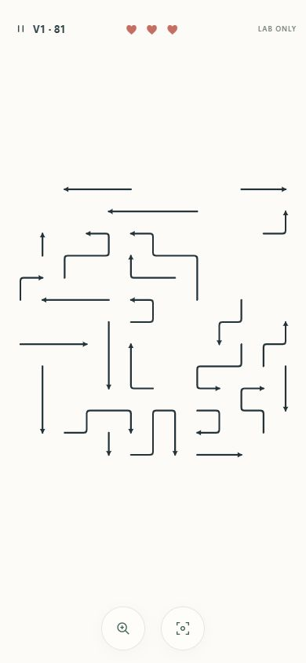
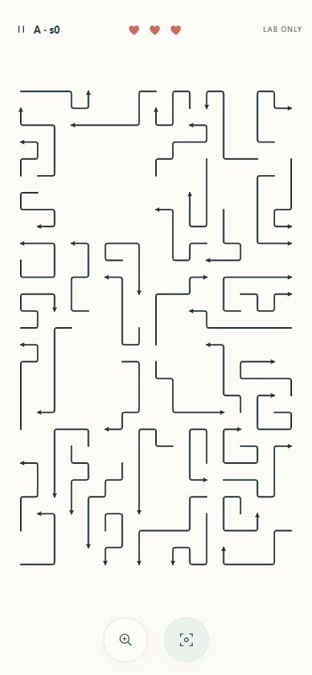
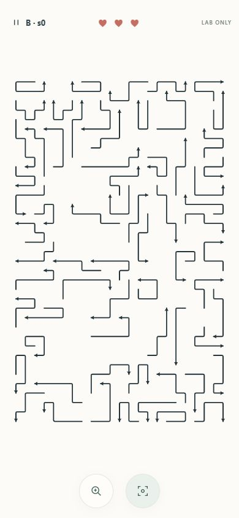

# FLOWLINE — Phase 4.6 Dense v2 feasibility handoff

Date: **15 October 2026**, Asia/Karachi. Status: **prototype implemented, verified and stopped for owner review**.

## Decision and scope

**A: REVISE. B: REVISE. C: NO-GO for implementation now.** Tall, winding, independently solvable original boards are feasible. Generation reliability, composition variety and physical-phone targeting still need work before a separate Dense campaign can ship. See [candidate comparison](DENSE_V2_CANDIDATE_COMPARISON.md) for the concise decision table.

The prototype is isolated in new versioned modules and a dev-only QA lab. The existing campaign, `getLevel(n)`, procedural-v1 recipe, fixtures, score thresholds, immutable engine, renderer, input, settings and progress storage were not edited. No Dense campaign menu, unlocks, save store or migration was added. No Phase 5, audio/haptics, native component download, commit, push or deployment occurred.

Read the Phase 4.5 handoff, Dense v2 proposal, complete Phase 4.6 prompt, Phase 3 handoff and actual generator/solver/state/rules/rendering/input/session/persistence/test contracts. Git initially contained modified README and the existing untracked project/spec/native files. Preserved that state; Git inspection used a command-scoped ownership exception. No dependency changes.

## Running now / how to test

- **Original production preview:** [http://127.0.0.1:4173/](http://127.0.0.1:4173/).
- **Isolated research lab:** [http://127.0.0.1:5173/research/dense-v2/](http://127.0.0.1:5173/research/dense-v2/).
- **Actual screenshot gallery:** [http://127.0.0.1:5173/docs/verification/dense-v2-gallery.html](http://127.0.0.1:5173/docs/verification/dense-v2-gallery.html).

Both local endpoints returned HTTP 200. Hidden local processes were left running for review: lab Vite process **14704**, production preview **14884**. No public deployment. The previous preview was no longer listening, so it was restarted using the verified build.

The original preview's old browser tabs were on internal error pages. Browser security policy blocked access to that error-page protocol; automatic approval review then denied a fresh 4173 tab as a workaround for the prior block. No further browser action against that origin was attempted. Its server was verified by HTTP 200 before the denial, but the original app's GUI was not rechecked in this phase. The already-authorized **5173 research lab remains open and playable**; the original-game URL can be opened manually, or a further browser-opening attempt needs owner approval. This is a browser approval limitation, not an APK/build or engine failure.

In **Lab controls**, choose a family, uint32 seed and optional requested path count, then Generate sample. Blank count means a seeded target within that family's range. Challenge/Zen and restart use the actual engine. Magnify/reset, pinch/wheel/pan and keyboard selection are the existing renderer controls. Research play is session-only and discarded on reload.

Useful requests:

| Family / seed / requested count | Reproducible result |
| --- | --- |
| A / 0 / blank | 44 paths, 17×29 |
| B / 0 / blank | 66 paths, 23×37 |
| B / 0 / 85 | Exactly 85 paths, 23×37 |
| B / 1 / 85 | Typed deterministic budget failure; no partial board |

The lab was left on a fresh A/seed 0 sample, **44 remaining, three hearts, zero attempts**, with the lab-only Canvas motion override enabled for review. [Final native 320px capture](verification/dense-v2-ready-for-review-320.jpg). Temporary viewport control was reset through the documented browser API. The separate 390px and landscape evidence below has verified native image dimensions.

The lab's campaign link points to port 4173, preserving the user's existing preview origin rather than silently switching to a separate dev-origin campaign. The lab itself imports no persistence/settings/session store and performs no storage writes. It is **not included in the production build or Android web assets**.

## Files and APIs

| New file(s) | Responsibility |
| --- | --- |
| `src/game/dense-v2/generator.ts` | Versioned deterministic bounded reverse construction, capacity checks, typed results, immutable success data. |
| `src/game/dense-v2/metrics.ts` | Independent verification and real Challenge replay, graph/trace/length/turn/direction/composition metrics. |
| `src/research/dense-v2/worker.ts` | Typed research request/reply protocol; generation and verification outside input/RAF. |
| `src/research/dense-v2/lab.ts`, `lab.css` | Interactive real-Canvas lab, engine transitions, committed cancellation, controls, truthful loading/failure/results, bounded paint samples. |
| `src/research/dense-v2/view-metrics.ts` | Pure viewport/contact analysis using the exact existing transform, line style, clip and targeting function. |
| `research/dense-v2/index.html`, `README.md` | Explicit non-production entry and local reproduction instructions. |
| `scripts/dense-v2-sample.mjs` | Fixed seed/config corpus, repeat determinism checks, generation CPU timing, layout fingerprints, raw metrics and failed cases. |
| `scripts/dense-v2-reference.mjs` | Verifies pinned JSON by default; explicit `--write` only for intentional fixture maintenance; measures view/contact cases. |
| `src/tests/dense-v2.test.ts` | 114 new correctness, bounds, failure, immutability, reference, replay, upper-count and mobile geometry tests. |
| `src/tests/fixtures/dense-v2-r2-{a,b}-seed0.json` | Two pinned complete serialized r2 results, including real geometry, witnesses, metrics and work statistics. |
| `docs/verification/DENSE_V2_*.json`, `dense-v2-*.jpg/html/py` | Raw measured evidence, native-size captures, gallery and reproducible pixel analysis. |

Primary research API:

```ts
generateDenseLevel(seed: number, options?: DenseOptions): DenseResult
verifyDenseCandidate(value: unknown, witness: readonly string[]) // verified/failure union
measureDenseLevel(level: Level): DenseMetrics
```

Recipe: **`procedural-v2-feasibility-r2`**. Level IDs include this namespace, seed and canonical configuration; automatic count is explicitly tagged `auto` in identity. Arrow IDs are local insertion-order `dense-arrow-001`, etc. Same version/config/seed serializes identically. Geometry uses the unchanged private Mulberry32 stream, integer bounds and deterministic iteration/tie order; no clock, environment randomness, storage or browser state influences generation.

The r1 experiment used the same 70% target fill for both grids. B's pilot returned only 8/24 successes. **R2 explicitly versions the geometry change** to a 62% B target fill; A retains its 70% target fill. A bounded local-repair experiment was less reliable in its small pilot and is disabled by default. Its optional bounded path remains tested. Early pilot files are retained as exploration evidence; current references and final reports identify r2 and include generator/metrics source SHA-256 hashes.

## Construction, proof and bounds

The existing load validator supports orthogonal, non-overlapping, self-ray-clear paths on dimensions up to 128. V1's 7-cell/3-turn generator limits are recipe limits, not new domain restrictions. Dense families remain within the unchanged validator; no limit was broadened.

Defaults:

| Setting | Value |
| --- | --- |
| A | 17×29, automatic target 40–55 |
| B | 23×37, automatic target 60–85 |
| Path length / turns | 3–18 cells, at most 6 turns |
| Accepted occupancy bounds | 56–80% |
| Candidate boards | At most 4 |
| Proposals per insertion slot | At most 96 |
| Proposals across all candidates | At most 26,000 |
| Local repairs | 0 by default |

Custom research options remain bounded: length at most 24, turns at most 6, candidates at most 4, proposals/slot at most 192, global proposals at most 60,000 and repairs/candidate at most 6. Width/height are fixed by family; unsupported options/families fail. Expert is not implemented.

1. Enumerate free head/direction candidates with clear cardinal exit rays using a bounded integer occupancy accelerator. Grow each body backwards, first opposite the outward heading, excluding other occupancy, repeated cells, bounds violations and the head's own ray. Rank valid proposals for winding geometry, target length and new dependencies.
2. Before every accepted insertion, check the head lane again with the unchanged canonical `firstBlocker`/occupancy implementation. Later arrows may block earlier ones.
3. Reverse insertion order gives the witness: removing the latest arrow restores the exact occupancy in which the preceding insertion was proved clear. Induction proves legal removal of every path. Optional local repair only deletes a bounded suffix and rebuilds occupancy/pressure before further insertions.
4. Validate the completed board with unchanged `validateLevel`. Run the independent solver, which sees only playable Level data. Replay **both witness and independent order** with real `attemptMove`/`completeEscape` in Challenge to `won`, hearts 3 and mistakes 0.
5. Require exact sampled/requested count, mean length ≥6, mean turns ≥1.5, ≥70% bent paths, sufficient dependency edges/depth, initial safe fraction ≤0.5, minimum occupancy and near-full grid span. Return a frozen Level/result only after those gates.

Automatic count is sampled per candidate within the configured family range. An explicit count remains fixed for all candidates and cannot be silently reduced. There is no partial-board success or arbitrary unverified fallback. Failure discriminants are `invalid-seed`, `invalid-options`, `impossible-capacity`, `budget-exhausted` and `verification-failed`.

Capacity preflight rejects impossible minimum-cell/maximum-density or maximum-cell/minimum-density combinations before construction. Actual samples demonstrate capacity rather than assuming full utilization: A 44×7.75 = **341/493 cells**; B 66×8 = **528/851**; B85 85×6.2118 ≈ **528/851**. Packing/head-lane constraints still cause failures even where arithmetic capacity permits a request.

Work and memory are bounded structurally. Family dimensions cap capacity at 851 cells and count at 85; occupancy/pressure use two fixed `Uint16Array`s, eligible heads at most four per cell, and paths at most the configured length. Every outer iteration inserts, consumes a bounded repair or stops. The global proposal limit dominates; head scanning is bounded by dimensions/count/candidates/repair limits. No geometry cache or unbounded search is retained. Solver traces can contain O(count²) safe-ID entries. The lab owns one worker/installed sample, terminates superseded work, guards stale replies/completions and caps paint samples at 256. No perpetual RAF was added. Long-session browser memory behavior is not claimed as measured.

Counters distinguish short growth, packing stalls and quality rejection. Accepted insertion totals include discarded candidates; proposal totals include valid alternatives that lost ranking. Packing can count both a stall and rejection of that candidate, so rejection counters are not disjoint probabilities or `proposals - final arrows`. Raw statistics preserve this distinction.

## Measured generation and diversity

Final runtime: **Node v22.22.1, Windows, Intel Core i5-6500 @3.20GHz**, using a Vite SSR loader. Timing wraps generation including canonical verification, independent solving, both real engine replays, composition metrics and immutable output. Each case is regenerated and compared outside the timed call, then replay-verified again. Mean/p50/p95/max include failed calls. p95 is nearest rank; with 12 cases it equals the maximum. Timings include JIT/cold-call/load effects and are not phone results.

| Final r2 corpus | Cases | Verified successes / distinct layouts | Failure rate | Mean / p50 / p95 / max |
| --- | ---: | --- | ---: | --- |
| A, automatic, seeds 0–127 | 128 | 119 / 119 | 7.03% | 47.39 / 44.79 / 83.85 / 108.76ms |
| B, automatic, seeds 0–23 | 24 | 18 / 18 | 25.00% | 97.73 / 96.21 / 153.99 / 250.57ms |
| B, explicit 85, seeds 0–11 | 12 | 9 / 9 | 25.00% | 117.76 / 109.78 / 254.75 / 254.75ms |

**164 distinct seed/configuration cases, 146 verified distinct layouts, 18 typed budget failures, zero invalid successes.** Numeric seeds overlap across families/count configurations. This does not claim 1,000 dense successes. All calls were repeated for deterministic serialized output. Layout uniqueness hashes exclude Level ID/seed and use direction/cell geometry.

A expanded from a 24-seed pilot after correctness/budget/visual checks. B's pilot remains insufficiently reliable, so B was not expanded to a 100+ seed corpus; the additional 12-case explicit-count experiment isolates upper-count packability. C was deferred because A/B still need revision.

Failed seeds, all `budget-exhausted`:

- A automatic: **2, 22, 36, 46, 56, 66, 73, 84, 107**.
- B automatic: **2, 3, 8, 9, 10, 20**.
- B explicit 85: **1, 5, 6**.

Raw evidence: [A 128](verification/DENSE_V2_A_128.json), [B pilot r2](verification/DENSE_V2_B_PILOT_R2.json), [B explicit 85](verification/DENSE_V2_B_UPPER_85.json). These include every success/failure, fingerprints, histograms, solver traces, proposal/work/rejection counts and source hashes. Total proposals: A **1,110,528**, B auto **316,672**, B85 **212,688**. Maximum observed positive post-call heap deltas: **15.29 / 13.03 / 12.45 MB** respectively; GC affects these deltas, and they are not peak-memory measurements or device RAM budgets.

Across successful default samples, A averaged 46.80 arrows, 69.05% occupancy, length 7.33, turns 2.99, 67.34 graph edges and depth 7.87. B averaged 69.06 arrows, 61.56% occupancy, length 7.64, turns 3.00, 117.61 edges and depth 9.44. A's observed count range was 40–55 and max path length 12; B auto 60–77 and max length 11. Both reached six turns. Although the default cap is 18, long tails near that cap were not demonstrated. Straight paths were only **87/5,569 A paths** and **10/1,243 B-auto paths**; the recipe is strongly biased toward bends and tight length distributions.

No large-scale nested-corridor grammar was implemented: these are original interleaving local winding paths. Deliberate long/straight mixes, regional hierarchy, directional balance and head clustering remain composition revisions. B85 seed 0's left-facing share (44/85) is a concrete weakness. More count is not automatically more complexity, density or beauty.

## Geometry, difficulty and visual measurements

The API retains descriptive dependency/solver metrics from the existing analyzer and **discards its legacy score/tier**. Dense Levels omit `difficulty`. No easy/hard/expert claim is assigned by reusing v1 thresholds. Histograms, all four head counts, safe-choice trace, forced-choice stretches, occupied connected groups, row/column negative-space arrays, empty bands, head clustering and grid bounds are in the raw metrics. Occupied-cell adjacency groups describe grid proximity, not drawn paths joined together. Human difficulty remains unvalidated.

Representative data:

| Sample | Arrows | Occupied / capacity | Mean/max length | Mean/max turns | Edges / depth | Initial safe | Longest forced stretch |
| --- | ---: | --- | --- | --- | --- | --- | --- |
| A seed 0 | 44 | 341/493 = 69.17% | 7.75 / 9 | 3.25 / 5 | 73 / 8 | 40.91% | 1 |
| B seed 0 auto | 66 | 528/851 = 62.04% | 8.00 / 10 | 3.09 / 6 | 112 / 9 | 33.33% | 3 |
| B seed 0 explicit 85 | 85 | 528/851 = 62.04% | 6.21 / 9 | 2.61 / 5 | 167 / 13 | 36.47% | 4 |

[Native screenshot gallery](verification/dense-v2-gallery.html). Same viewport, **different puzzles**, at 390×844:

| V1 Level 81, unchanged | Research A seed 0 | Research B seed 0 |
| --- | --- | --- |
|  |  |  |

| 390×844 measurement | V1 Level 81 | A seed 0 | B seed 0 | B85 seed 0 |
| --- | --- | --- | --- | --- |
| Actual visible stroke bounds | 342×344 | 341×594 | 343×557 | 341×558 |
| Ink pixels / 358×676 safe rectangle | 1.80% | 4.12% | 4.72% | 4.56% |

The extra portrait use is real new tall geometry. The Phase 4.5 UI/transform/renderer was not enlarged or altered. All arrows are interactive engine paths. Identical occupied-cell counts can yield different ink coverage: B66 and B85 both use 528 cells, but splitting into more paths changes gaps/heads. Pixels were counted with a documented dark/teal threshold within the safe rectangle, excluding HUD/controls. JPEG/anti-aliasing introduce a few pixels of tolerance. [Pixel results](verification/DENSE_V2_IMAGE_METRICS.json), [reproduction script](verification/dense-v2-image-metrics.py).

### Actual phone-scale fit and controls

Every captured gameplay document equals its viewport dimensions; no page scrolling or framed mini-Canvas. Cells remain uniformly scaled and clip to the existing overlay-safe rectangle. The same 48px Pause and 56px floating targets are retained.

| Family / viewport | Overview cell | Stroke / head | Actual working capture | Minimum zoom for 24px / 32px cell |
| --- | --- | --- | --- | --- |
| A · 320×568 | 13.57px | 1.80 / 4.20px | 2.25× → 30.54px | 1.77× / 2.36× |
| A · 390×844 | 21.13px | 1.80 / 4.20px | 2.25× → 47.53px | 1.14× / 1.51× |
| A · 844×390 | 12.07px | 1.80 / 4.20px | 2.25× → 27.16px | 1.99× / 2.65× |
| B · 320×568 | 10.56px | 1.80 / 4.20px | 3.375× → 35.63px | 2.27× / 3.03× |
| B · 390×844 | 15.36px | 1.80 / 4.20px | 2.25× → 34.57px | 1.56× / 2.08× |
| B · 844×390 | 9.39px | 1.80 / 4.20px | 3.375× → 31.69px | 2.56× / 3.41× |

The unchanged 4× cap can reach 32px/cell in all these cases. Working views show a clipped portion; pan/reset is necessary. Tall geometry makes landscape overview narrower, which is disclosed rather than stretched away. The 320px B overview has visibly small details; physical low-DPI/outdoor readability is pending.

| Size | A overview / selected working view | B overview / selected working view | Different v1 comparison |
| --- | --- | --- | --- |
| 320×568 | [Overview](verification/dense-v2-A-s0-overview-320.jpg), [2.25×](verification/dense-v2-A-s0-working-320.jpg) | [Overview](verification/dense-v2-B-s0-overview-320.jpg), [3.375×](verification/dense-v2-B-s0-working-320.jpg) | [V1 81](verification/dense-v2-v1-level81-comparison-320.jpg) |
| 390×844 | [Overview](verification/dense-v2-A-s0-overview-390.jpg), [2.25×](verification/dense-v2-A-s0-working-390.jpg) | [Overview](verification/dense-v2-B-s0-overview-390.jpg), [2.25×](verification/dense-v2-B-s0-working-390.jpg) | [V1 81](verification/dense-v2-v1-level81-comparison-390.jpg) |
| 844×390 | [Overview](verification/dense-v2-A-s0-overview-landscape.jpg), [2.25×](verification/dense-v2-A-s0-working-landscape.jpg) | [Overview](verification/dense-v2-B-s0-overview-landscape.jpg), [3.375×](verification/dense-v2-B-s0-working-landscape.jpg) | [V1 81](verification/dense-v2-v1-level81-comparison-landscape.jpg) |

Additional [85-path overview](verification/dense-v2-B85-s0-overview-390.jpg). Exact Canvas/HUD/control bounds, DPR/view diagnostics, generation timing, state metadata and filenames: [browser layout record](verification/DENSE_V2_BROWSER_LAYOUTS.json). All source screenshots are native JPEG dimensions, not resized mockups.

### Contact feasibility

[18 view/zoom cases](verification/DENSE_V2_VIEW_ANALYSIS.json) use the exact existing 22px-radius (44px diameter) finger search and ambiguity rule. Probe every visible segment midpoint, then ±6px and ±22px axis offsets. Contacts outside the safe region are excluded from targeting. These are hypothetical intended-contact displacements, not measured finger error rates. Zoom tests use centered pan, so they cover the visible subset, not every offscreen path at each zoom.

- All exact and ±6px probes selected zero wrong arrows; exact midpoint contacts were all correct for the representative overviews.
- At 320px, ±6px jitter caused **254/1,188 A** and **329/1,848 B** ambiguity results; B landscape **636/1,848**. Ambiguity makes no attempt or heart deduction.
- ±22px stress offsets exposed possible wrong-intention picks in overview: **382/1,158 in-safe A contacts** and **623/1,794 B contacts** at 320px. Nearest-line selection cannot infer an intention displaced toward a neighboring line.
- At centered 4×, sampled wrong stress picks were zero; B still had **14 ambiguous contacts at 320px and 16 in landscape**. In-safe exact/±6px working probes were unambiguous. This is not proof of whole-board/physical-finger correctness.

Recommend a reviewed overview-magnify-before-attempt or preview/confirm policy, plus deliberate candidate selection/confirmation at the cap. The existing max-zoom ambiguity message can repeat without further magnification; no silent guessing should replace it. The shipping target heuristic was preserved. This unresolved intention policy is a release gate, not hidden behind a passing unit count.

Measured Node hit-call p95 was at most **0.2643ms** across these cases; maximum individual call **2.5087ms**. This excludes event dispatch/compositing and is not phone input latency or proof of the future device budget.

## Hands-on gameplay and motion

Used browser GUI interactions, actual generated boards and the real renderer/engine:

- A 390px: direct body tap at the top-right bent path removed exactly one arrow, 44→43, three hearts retained. An internal blocked body tap reduced hearts 3→2 without removal.
- On both families, selected actual winding bodies in working views at 320px, 390px and landscape. Working screenshots show genuine selected blocked paths, not decorative highlights. Pan did not create another attempt; reset restored overview.
- A 320px: a contact between two distinct nearby paths magnified to 1.5× with **44 remaining, three hearts, zero attempts**. Deliberate retap selected one actual blocked path and made exactly one attempt. [Ambiguity capture](verification/dense-v2-A-ambiguity-320.jpg). Empty HUD/control gaps were rejected by the safe-region contract.
- In Zen, completed all 44 A paths through actual arrow-key selection and Enter, reaching genuine engine victory after 281 scripted attempts, including blocks. [Victory](verification/dense-v2-A-real-victory-390.jpg). This QA input sequence is not a human difficulty measurement. In Challenge, three actual blocked attempts produced engine defeat, followed by accessible lab/restart actions. [Defeat](verification/dense-v2-A-real-defeat-390.jpg).
- Loaded the real 85-path B request through the lab. Its deterministic failing seed showed a visible typed error with the Canvas hidden and view controls disabled, then a valid A request recovered normally. [Failure](verification/dense-v2-B85-failure-390.jpg).
- Inspected real 320×568, 390×844 and 844×390 overview/working views and the different v1 Level 81 through the same renderer. No production campaign run was played/rewritten for these checks.

The host enforces reduced motion. Shared production behavior remains untouched. The lab has an explicit, session-only Canvas motion QA override; enabled it for actual normal-motion extractions without changing OS settings or stored preferences. Shared CSS result entrances still respect OS media rules. Reduced-mode Zen/Challenge checks also ran.

Finite normal-motion records:

| Sample | Actual completion | Observed extraction frames / maximum gap | Maximum draw diagnostic | Recent sampled draw mean / p95 |
| --- | --- | --- | --- | --- |
| A 44-path board | 44→43, hearts 3 | 24 / 18.1ms | 0.8ms | 0.267 / 0.4ms |
| B 66-path left exit | 66→65, hearts 3 | 23 / 19.0ms | 0.7ms | 0.349 / 0.5ms |

Actual frames: [A bent extraction](verification/dense-v2-A-motion-0.jpg), B [early](verification/dense-v2-B-left-motion-0.jpg), [middle](verification/dense-v2-B-left-motion-2.jpg), [later](verification/dense-v2-B-left-motion-5.jpg). Full DOM sample records: [A](verification/DENSE_V2_A_BROWSER_MOTION.json), [B](verification/DENSE_V2_B_LEFT_MOTION.json). The tail follows original bends as the head extends outward; the unchanged engine commits only from the valid current completion callback. Safe clipping can hide a departing path before its tail completes travel beyond the full Canvas.

Paint costs are the renderer's existing rounded CPU diagnostics; the bounded MutationObserver samples may coalesce paints and span recent draws/restarts. They exclude compositing and are not a controlled whole-frame/device benchmark. Foreground desktop gaps do not establish phone frame-rate/thermal performance. No physical Android, cutout, system-bar, low-DPI or multitouch success is claimed. Existing automated gesture/capture tests remain green.

## Tests, build and preservation

| Check | Actual result |
| --- | --- |
| Starting baseline | **1,360 tests / 17 files**, 19.01s, exit 0 |
| Final `npm run typecheck` | PASS, exit 0 |
| Final `npm run test` | **1,474 tests / 18 files**, **18.72s**, exit 0 — original 1,360 plus 114 new cases |
| Existing v1 seed regression | **1,000/1,000 generated and verified**; separate from dense counts |
| Pinned r2 references | PASS, both complete serialized results verified without rewriting |
| `npm run build` | PASS, exit 0; 27 modules, Vite 820ms; HTML 0.67kB, CSS 18.92kB, JS 62.87kB (gzip 0.40 / 4.54 / 21.74kB) |
| `npm run android:sync` | PASS, exit 0; rebuild 87ms, sync 0.126s |
| Production isolation | Four shipping web files byte-identical to Phase 4.5; no dense research references in bundle |
| Android copies | All four match `dist` SHA-256 |
| Protected original files | **166/166 SHA-256 matches**, including critical domains, all old fixtures/tests, UI/input/rendering/storage/packages/config and prior handoffs/evidence |
| Browser console | No app errors/warnings captured during inspected lab gameplay |
| Native APK | Not compiled; expected debug APK absent |

The new tests cover malformed seeds/options, uint32 endpoints, capacity contradictions, tiny budgets, bounded repair, pinned deterministic serialization, known successful/failing pilot seeds, independent witness/solver replays, frozen geometry and immutable transitions, valid deadlock/forged witness rejection, exact upper-count/no-fallback behavior, fit/zoom/contact geometry and the 4× working-view limit. Existing collision, extraction, gesture, settings, replay/progress and v1-generation tests were preserved.

The existing seed suite rewrites two historical timing reports. Their original bytes were backed up before testing, the latest v1 sample was archived as [DENSE_V2_V1_REGRESSION.json](verification/DENSE_V2_V1_REGRESSION.json), and both Phase 3 reports were restored before final preservation checks. No old timing evidence was replaced in this phase.

Evidence: [preservation hashes](verification/DENSE_V2_PRESERVATION.json), [shipping/native asset hashes](verification/DENSE_V2_ANDROID_ASSETS.json), [check summary](verification/DENSE_V2_CHECKS.json). `dist/assets/index-yKL7_gK7.js` and `index-Cvc58Zmr.css` are unchanged; dense modules are typechecked/tested but not reachable from the shipping entry.

Native prerequisites were rechecked: selected Java **1.8.0_51**, no configured `JAVA_HOME`/Android SDK variables, default SDK directory absent, `adb` unavailable. Java 21/SDK configuration remains a separate blocker. Capacitor synchronization is not APK compilation. Nothing was downloaded to work around it.

Reproduction commands:

```powershell
npm run typecheck
npm run test
node scripts/dense-v2-reference.mjs
node scripts/dense-v2-sample.mjs --family A --count 128 --out docs/verification/DENSE_V2_A_128.json
node scripts/dense-v2-sample.mjs --family B --count 24 --out docs/verification/DENSE_V2_B_PILOT_R2.json
node scripts/dense-v2-sample.mjs --family B --count 12 --arrows 85 --out docs/verification/DENSE_V2_B_UPPER_85.json
npm run build
npm run android:sync
```

Running the old full seed suite regenerates historical timing files; preserve/archive them as described above when reproducing. `--write` on the reference runner is intentionally separate and should only accompany a reviewed recipe/fixture change.

## Future campaign proposal — documentation only

A future opt-in **Dense** campaign should use a separate key such as `flowline.dense.progress.v1`, an explicit dense recipe allowlist/resolver and a replay identity containing recipe revision, seed, normalized configuration and geometry fingerprint. Validate saved witness/history against the matching immutable geometry. Never resolve an old identity using a new recipe.

Keep `flowline.progress.v1`, its decoder/replayer, numbered v1 mapping, settings and active run untouched. Dense and v1 unlocks should initially be independent; any cross-campaign achievements/unlocks require an explicit policy. No automatic migration on launch. If a unified shell is later approved, test old-save round trips and explicit opt-in without rewriting existing progress. **No such key/store, UI selector or migration is implemented here.**

Before shipping: improve A/B success rates and composition in a new geometry recipe revision; choose and test intention/confirmation behavior; run physical low/midrange-phone readability/touch/performance/long-session checks; obtain human difficulty feedback; approve campaign namespace/progression rules; install native prerequisites through a separate authorized task. C's 90–120+ counts remain exploratory: 120×8 needs 960 cells (79.0% of 27×45 or 62.5% of 32×48) before spacing/head-lane constraints. Current A/B evidence does not validate C.

**Stopped for owner review. No Phase 5 or shipping Dense campaign work should start without approval.**
