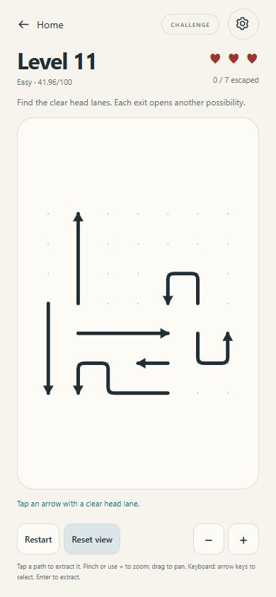
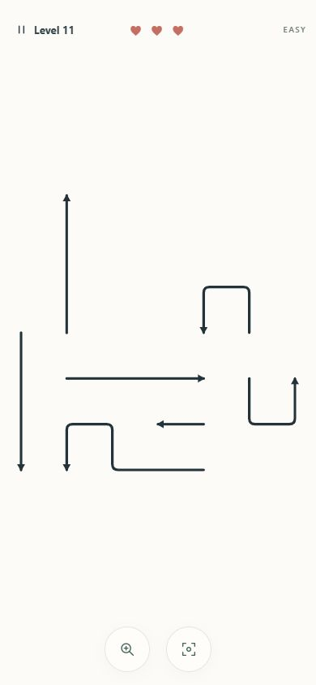

# FLOWLINE — Phase 4.5 handoff

Date: 15 October 2026, Asia/Karachi. Status: **implemented and verified; stopped for visual review.**

## Delivered

Gameplay is now a distinct full-viewport mobile screen: an uninterrupted ivory Canvas, compact three-part HUD, thin dark paths and two floating circular view controls. The framed board, large heading, permanent instructions, numerical difficulty score and rectangular gameplay button row are removed. Restart, Home, settings, help, mode changes and secondary view controls are in Pause. Restart remains two taps away.

This fixes the small-board interface. It **does not deliver reference-level procedural density**: v1 Level 81 still has 25 short paths on a square grid. Taller, longer, nested dense compositions require a separately approved/versioned generator. See [DENSE_LEVEL_V2_PLAN.md](DENSE_LEVEL_V2_PLAN.md); it is a proposal, not an implemented feature.

Read the complete redline, blueprint, Phase 4 handoff, actual renderer/input/session/storage/engine/tests and running UI. Initial Git status already had modified README and the untracked application/spec/native files; preserved that state without a commit. No dependencies, v1 recipe, level identities, progression schema, pure engine rules or existing test fixtures were changed. No Phase 5, audio/haptic implementation, v2 generator, commit, push or deployment occurred.

## Implementation

| File | Change |
| --- | --- |
| `src/main.ts` | Full Canvas/HUD composition; native Pause sheet; help/settings return; compact result sheets; transient friendly feedback; real-level practice access isolated from campaign saves. |
| `src/gameplay.css` | Gameplay-only full viewport/dynamic height, inset support, no document scroll, minimal HUD, 56px round controls, landscape side rails, accessible dialog styling and reduced-motion-aware result entrance. |
| `src/styles.css` | Removed retired Phase 4 gameplay-card rules; retained Home, original art preview, settings and shared controls. |
| `src/graphics/mobile-layout.ts` | Shared pure CSS-pixel safe rectangle and overlay layout, portrait/landscape/insets, bounded stroke/head/corner proportions. |
| `src/graphics/viewport.ts` | Optional translated safe rectangle; maximally fit equal-axis cells, exact inverse, safe-centered anchored zoom and pan bounds. Legacy default fit remains supported. |
| `src/graphics/game-board.ts` | Full-surface DPR rendering and safe clipping, no grid dots in gameplay, crisp rounded paths, finger ambiguity handling, overlay-region rejection, finite error pulse and victory bloom; preserves cancellable snake extraction. |
| `src/graphics/celebration.ts` | Original deterministic 20-particle warm teal/coral/ivory bloom, bounded/fading, 650ms finite effect. |
| `src/input/hit.ts` | Finger/mouse targeting with ambiguous-contact result; segment clipping prevents hitting invisible paths outside the safe region. Original legacy hit function retained. |
| `src/gameplay/session.ts` | Optional practice isolation: no persistence or unlocks; default campaign behavior unchanged. |
| `src/ui/settings.ts` | Optional close callback returns gameplay settings to Pause; original storage/effective reduced-motion behavior retained. |
| `src/tests/mobile-layout.test.ts` | 37 additional layout, geometry, targeting, practice/save-boundary and finite-effect cases. |
| `src/tests/mobile-board.test.ts` | 8 additional real renderer/input-port integration cases. |

Home's optional **Explore a puzzle** disclosure loads real generated Levels 11, 41 and 81 without unlocking them or replacing the saved campaign. Practice is labelled in Pause. Its next/restart/win logic still uses the real engine; its persistence/unlock boundary is tested. Continue retains the saved campaign.

### Geometry and interaction contract

The Canvas spans the whole gameplay viewport. `gameplayLayout` subtracts safe insets and reserves the HUD/control regions. The same returned rectangle positions overlays and drives drawing, inverse transforms, clipping, pinch anchors, zoom centers, pan limits and tap eligibility. The production integration reads `env(safe-area-inset-*)` through CSS variables. Existing `viewport-fit=cover` and Capacitor SystemBars `insetsHandling: native` remain unchanged; physical cutout verification is still outstanding.

Grid centers fit inside the safe rectangle with an additional 10px head/stroke allowance. X/Y cell scale is identical. A square level is centered, never stretched vertically. Canvas backing dimensions use DPR independently of CSS input coordinates. Zoom remains 1–4×; magnify, reset, pinch, pan, wheel and keyboard selection remain functional. Landscape moves HUD to the left and floating controls to the right.

Finger targeting uses a 22px radius (44px diameter), mouse 14px. Two plausible paths whose distances differ by at most 7px produce **no engine attempt or heart loss**; the view magnifies around the contact and requests a deliberate retap. Removed/offscreen paths are excluded. Taps outside the safe rectangle cannot reach the engine even through empty overlay gaps. Native button targets intercept their own events; transparent overlay containers leave the remaining Canvas surface available. Existing 8px drag suppression, pinch suppression, capture cancellation and remaining-finger pan behavior are retained.

All engine moves remain immutable. Misses, ambiguity, drags and pinches cannot deduct a heart. Blocked attempts still highlight the attempted path and actual blocker; feedback is a short toast/live announcement. Hidden accessible counts, help and QA DOM attributes remain available without numerical debugging on the playfield. Native dialogs preserve keyboard access; Escape from Settings returns to Pause. Home/settings/preview continue to work separately.

### Motion and reference observation

Decoded the supplied local MP4 with the installed Windows media APIs, without downloading software. It is **11.8828 seconds, 576×1312**. Inspected six stills at 0/2/4/6/8/10 seconds in [phase045-reference](verification/phase045-reference/). It shows a tutorial labelled Level 4: slender long/nested paths, compact top controls/hearts, head-first extraction with the trailing body following its path, colored departure emphasis and completion confetti. It does not establish late-game arrow counts, hardness or generation rules. These frames are QA evidence only and are not bundled game assets.

Flowline retains its mathematically coherent centerline-window extraction: the tail follows the original bends, the head extends along its cardinal ray and the whole path leaves the full Canvas viewport. It does not translate a bent arrow rigidly. The existing 180–450ms bounded smoothstep driver is unchanged; refined rendering adds restrained teal emphasis, a small terminal fade/thinning, rounded joins and a finite 180ms blocked pulse. Victory adds an original 650ms gentle bloom and a 300ms result-sheet entrance. No borrowed path/art/audio assets or decorative noninteractive arrows were added.

Production respects **stored reduced motion OR the OS preference**. This host enforces reduced motion. Normal motion was therefore additionally inspected through the explicit opt-in [motion lab](verification/phase045-motion-lab.html), which imports the actual production renderer, actual Level 4 and immutable engine, performs four complete legal solutions and never touches storage. Only the separate lab supplies `reduced: () => false`; production preferences/OS handling were not bypassed. This lab is outside the production bundle. To reproduce: `npm run dev -- --host 127.0.0.1 --port 5173`, then open `/docs/verification/phase045-motion-lab.html` and choose **Run full-motion sample**. The temporary verification server was stopped afterward.

Actual browser extraction frames [05](verification/phase045-motion-05.jpg), [06](verification/phase045-motion-06.jpg), [07](verification/phase045-motion-07.jpg) show a bent body straightening as its tail follows the path. [Bloom frame](verification/phase045-bloom-2.jpg) shows the actual finite completion effect. [Visible motion samples](verification/PHASE_04_5_VISIBLE_MOTION.json) end at **4 complete solutions**; the last extraction recorded 17 frames, a maximum observed gap of 17.0ms and maximum sampled draw cost of 0.2ms. An initial hidden-tab run was throttled; it is not presented as a frame-rate success. Foreground desktop samples are not Android performance results and Canvas draw timing excludes compositing/input latency.

## Before/after visual evidence

[Open the side-by-side comparison](verification/phase045-comparison.html). These are actual production browser screenshots of the same v1 Level 11 at 390×844, with 7 paths and three Challenge hearts:

| Phase 4 | Phase 4.5 |
| --- | --- |
|  |  |

| Measurement at 390×844 | Before | After |
| --- | ---: | ---: |
| Canvas CSS surface | 340×524 at (25,166.83) | 390×844 at (0,0) |
| Canvas area / viewport | 54.1% | 100% |
| Explicit safe play rectangle | No shared overlay-safe rectangle | 358×676 at (16,72) |
| Safe interactive height / viewport | — | **80.1%** |
| Actual dark path stroke bounds | 268×258 at (61,300) | **346×340 at (22,240)** |
| Stroke-bounds width / measured region | 78.8% of old Canvas | **96.6% of safe region** |
| Compact HUD | Large heading/prose plus separate controls | 56px content region; Pause target 48px high |
| Main view controls | Four rectangular buttons, 44px high | Two 56×56px circles, 20px apart |

Canvas area increased **84.8%**; the actual path bounding-box area increased **70.1%**. The prior running build measured 340×524 at this viewport; the redline's older approximately 244×182 screenshot is not substituted for this measured baseline.

The square path artwork occupies about 340px of the 676px-tall safe region. Roughly 336px of remaining vertical space is still blank around it. That space is now part of the zoom/pan play surface; creating meaningful paths there requires taller level geometry. The screenshot is not evidence that the artwork fills 80% of screen height. Grid occupancy, stroke-bounds area and actual ink pixel coverage are different measurements.

### Supported viewport matrix

All after captures: document dimensions equal viewport dimensions; no gameplay page scroll; Pause is at least 48px high and floating controls are 56×56px.

| Viewport | Before Canvas | After Canvas | After safe rectangle | After Level 11 stroke bounds | Screenshots |
| --- | --- | --- | --- | --- | --- |
| 320×568 | 267×248 | 320×568 | 288×400 | 276×271 | [Before](verification/phase045-before-320.jpg), [after](verification/phase045-after-level11-320.jpg) |
| 360×800 | 307×480 | 360×800 | 328×632 | 316×311 | [Before](verification/phase045-before-360.jpg), [after](verification/phase045-after-level11-360.jpg) |
| 390×844 | 340×524 | 390×844 | 358×676 | 346×340 | [Before](verification/phase045-before-390.jpg), [after](verification/phase045-after-level11-390.jpg) |
| 430×932 | 380×560 | 430×932 | 398×764 | 386×380 | [Before](verification/phase045-before-430.jpg), [after](verification/phase045-after-level11-430.jpg) |
| 844×390 | 400×342 | 844×390 | 644×358 | 346×341 | [Before](verification/phase045-before-844.jpg), [after](verification/phase045-after-level11-844.jpg) |

The two pre-redesign scrolling pages at 320/360 had document heights 577/809px; the screenshot tool scaled their full-page captures to 305×541 / 345×767. Their original captures are retained and explicitly marked as scaled in pixel analysis. Baseline DOM dimensions above remain CSS measurements. The mandatory 390×844 pair, other before captures and **every after capture** are native-size images, not resized comparison mockups.

Pixel analysis uses a documented dark RGB threshold restricted to the Canvas/safe region, excluding HUD, pale dots and controls. JPEG/antialiasing introduce a few pixels of tolerance. Raw bounds, actual ink counts, normalization flags and source rectangles are in [image metrics](verification/PHASE_04_5_IMAGE_METRICS.json); the reproducible [Python script](verification/phase045-image-metrics.py) reads screenshots without modifying them. DOM bounds are in [baseline layouts](verification/PHASE_04_5_BASELINE_LAYOUTS.json) and [after layouts](verification/PHASE_04_5_AFTER_LAYOUTS.json).

### Actual Level 11 / 41 / 81 density assessment

| Level | Grid | Real arrows | Occupied cells / grid | Measured tier / score (QA only) | Dependency edges / longest chain | Visible stroke bounds at 390×844 |
| --- | --- | ---: | --- | --- | --- | --- |
| 11 | 7×7 | 7 | 28/49 = 57.14% | easy / 41.96 | 6 / 2 | 346×340 |
| 41 | 11×11 | 20 | 82/121 = 67.77% | hard / 73.37 | 31 / 6 | 345×340 |
| 81 | 13×13 | 25 | 105/169 = 62.13% | expert / 82.11 | 38 / 8 | 342×344 |

Screenshots: [Level 41](verification/phase045-after-level41-390.jpg), [Level 81](verification/phase045-after-level81-390.jpg). Exact IDs, original seeds, safe-choice traces and metrics: [level analysis](verification/PHASE_04_5_LEVEL_ANALYSIS.json).

All three centerline compositions span **94.4% of safe width** at 390px. Including arrowheads/stroke pixels, hard/expert span approximately **96.4% / 95.5%**, slightly above the redline's approximate 85–95% preference, with clear head margins and no clipping. This is an intentional maximal fit; it exceeds the sparse ≥80% benchmark. Paths are bounded at 1.8–3.1px width with proportional heads/corners; all are real interactive arrows. Expert is visually more complex than Level 11, but it is not a 40–120-arrow tall dense board and is not claimed to match the reference's composition or human difficulty.

## Verification results

Environment: Windows, Node v22.22.1, npm 10.9.4, TypeScript 5.9.3, Vitest 5.0.4, Vite 8.3.4, Capacitor 8.5.3. No dependency changes. Windows sandbox initially prevented Vite subprocess spawning; authorized checks ran with the normal local tooling outside that process restriction.

| Check | Actual result |
| --- | --- |
| Pre-change baseline | **1,315 passing tests**, 15 files, 18.29s, exit 0 |
| Final `npm run typecheck` | PASS, exit 0 |
| Final `npm run test` | **1,360 passing tests**, 17 files, **20.70s**, exit 0; original tests retained plus 45 new cases |
| Included seed regression | **1,000/1,000 generated and independently verified**, four profiles ×250; no failures |
| Final `npm run build` | PASS, exit 0; 27 modules, Vite 100ms; HTML 0.67kB, CSS 18.92kB, JS 62.87kB (gzip 0.40 / 4.54 / 21.74kB) |
| Final `npm run android:sync` | PASS, exit 0; rebuild 105ms, Capacitor synchronization 0.086s |
| Android web asset hashes | All four copied web files match final `dist` byte-for-byte; [asset report](verification/PHASE_04_5_ANDROID_ASSETS.json) |
| Protected original files | An **84/84 unchanged checkpoint** passed. The last test rerun then refreshed the two generated Phase 3 timing reports: **82/84 remain byte-identical**; all engine/tests/fixtures/storage/packages/native-source files remain unchanged. [Preservation report](verification/PHASE_04_5_PRESERVATION.json) |
| Browser diagnostics | No console errors/warnings during inspected production/lab gameplay |
| Native APK/device build | **Not performed / blocked**: installed Java 1.8.0_51, no configured Java 21 or Android SDK/adb, no debug APK |

The existing seed suite automatically rewrites `docs/PHASE_03_SEED_SAMPLE.md` and `docs/verification/PHASE_03_SEED_SAMPLE.json`. The last rerun refreshed those historical timing reports; they now describe this latest run rather than their original Phase 3 timings. No test source was changed. The same final results are separately archived as [PHASE_04_5_SEED_REGRESSION.json](verification/PHASE_04_5_SEED_REGRESSION.json). Removing only timing fields yields an exact match to the preserved Phase 4 seed regression report. Generation timings in the final Node worker: p95 easy 28.29ms, medium 28.67ms, hard 30.22ms, expert 68.80ms; expert maximum 127.39ms. These measured host timings are not phone benchmarks or a new recipe claim. Previous handoffs remain unchanged.

New tests exercise inset-aware bounds and overlay separation across six sizes, Android-like inset cases, exact inverse/anchored zoom/pan, real-level head margins, finger-sized ambiguity and retap, offscreen clipping, full Canvas DPR backing, HUD/bottom tap rejection, portrait/landscape targeting, stale RAF cancellation on orientation change, practice persistence isolation, committed pause boundaries, finite bloom/disposal and exactly-once reduced-motion completion. Existing geometry/extraction/pinch/state/progress suites remain intact.

### Hands-on production browser checks

- At 390×844, clicked an actual safe Level 11 body: removed exactly that path, kept three hearts, saved 1/7, reloaded and continued at 1/7. Restart restored identical geometry/three hearts. Original campaign was returned to 0/7, Challenge, unlocked through 12; settings preferences were retained.
- Empty HUD and bottom-control gaps caused no attempts. Magnify reached 1.5×; a mouse drag panned without removal; Reset returned to 1×.
- Three actual blocked attempts in isolated practice produced genuine heart loss and defeat. [Defeat screenshot](verification/phase045-defeat-390.jpg). Try in Zen restarted the same puzzle with unlimited retries and Zen status.
- Cleared the genuine Zen Level 11 through keyboard selection/Enter (15 safe/blocked attempts), reaching the engine's actual victory dialog. [Victory screenshot](verification/phase045-victory-390.jpg). No forced state or mocked win.
- Pause/resume, two-tap restart, Home, settings, Escape back to Pause and real 11/41/81 practice loads worked. [Pause screenshot](verification/phase045-pause-390.jpg). At 320×568, help expanded inside the scrollable native dialog and Keep flowing remained reachable. [Small-screen help](verification/phase045-help-320.jpg).
- Inspected actual gameplay at 320×568, 360×800, 390×844, 430×932 and 844×390. Portrait controls stayed in bounds; landscape used side rails and retained large square geometry. Final bundle: `/assets/index-yKL7_gK7.js`. The last navigation check found and fixed stale live feedback crossing puzzle boundaries; saved campaign restoration/settings return/blocked feedback were also verified in the production browser.
- Touch/pinch/capture sequences are covered through browser-port automated tests. This browser interface did not provide physical multitouch; **no physical touch, cutout, Android system-bar or device performance success is claimed**.

## Acceptance and remaining limits

| Requirement | Status |
| --- | --- |
| Full usable viewport, no framed mini-board | PASS in inspected browser viewports |
| ≥~75% interactive height at 390×844 | PASS: 80.1%; inset calculation tests also pass |
| Sparse maximum fit without geometric distortion | PASS: 94.4% centerline / 96.6% stroke width; equal-axis cells |
| Hard/expert width and crisp complexity | PASS maximal unclipped fit; stroke width slightly over approximate 95% target as disclosed |
| Compact HUD, two floating targets, accessible Pause/restart/help | PASS browser inspection and measured targets |
| No permanent gameplay prose/debug score | PASS; only transient feedback and accessible hidden text remain |
| Immutable engine, extraction, mode/hearts, saves, v1 recipes/tests | PASS automated and hands-on checks; protected bytes retained |
| Reference-style tall, long, dense puzzles | **Not delivered in this phase**; independent v2 proposal required |
| Real Android cutout/multitouch/low-DPI/performance | Pending physical-device QA after Java 21/SDK availability |

The remaining blank vertical bands are a level-shape limitation, not a hidden small Canvas. V1 density, future human difficulty calibration, physical Android validation and full-motion production observation on a host without enforced reduced motion remain review items. The finite lab verifies real renderer motion but does not replace those device checks. Sound/haptics remain existing truthful preferences for a later phase.

Ready for the owner's visual review and a decision on the separate dense-v2 proposal. **Do not begin Phase 5 or dense-v2 implementation without approval.**
